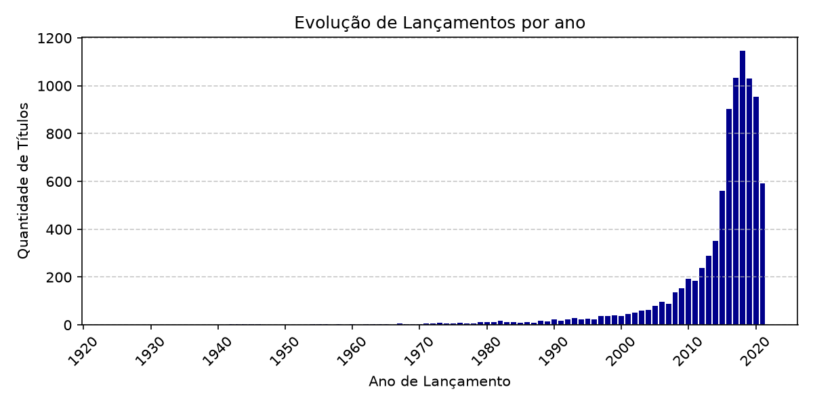
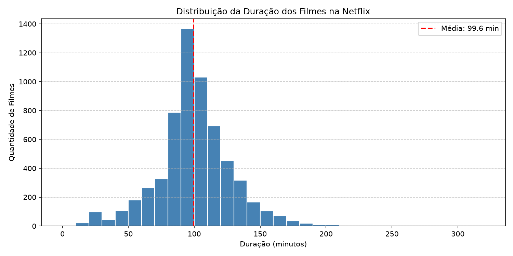

# Netflix EDA — Diagnóstico de Catálogo e Duração de Conteúdo

> **Nota:** Este projeto corresponde a uma **atividade acadêmica prática** (*Exercício 1.1: Diagnóstico de Catálogo e Duração de Conteúdo*), desenvolvida com foco em Análise Exploratória de Dados (EDA), limpeza de colunas com tipos mistos, estatística descritiva e visualização em Python.

---

## Objetivo da Atividade

Explorar o catálogo da Netflix a partir do dataset *Netflix Movies and TV Shows* para cumprir quatro etapas principais de diagnóstico:

1. **Carregamento e diagnóstico de qualidade:** inspecionar a estrutura do dataset e levantar os valores ausentes por coluna (com destaque para `director`, `cast` e `country`).
2. **Limpeza de dados mistos:** separar a coluna textual `duration` em duas colunas utilizáveis — uma numérica (`duration_int`) e uma categórica de unidade (`duration_type`: `min` para filmes e `Seasons` para séries).
3. **Estatística descritiva:** calcular medidas de tendência central (média, mediana, moda) e dispersão (desvio padrão) da duração dos **filmes** em minutos.
4. **Visualização gráfica:** construir um gráfico de barras com a evolução do número de lançamentos por ano e um histograma da distribuição de duração dos filmes.

---

## Sobre o Dataset

* **Arquivo:** `Dataset/netflix_titles.csv` (*Netflix Movies and TV Shows*)
* **Dimensões:** `8.807` registros e `12` colunas
* **Composição do catálogo:**
  * **Filmes (`Movie`):** `6.131` títulos (`69,6%`)
  * **Séries (`TV Show`):** `2.676` títulos (`30,4%`)
* **Período de lançamentos (`release_year`):** `1925` a `2021`

---

## 1. Levantamento de Valores Ausentes

Das 12 colunas originais, 6 apresentam valores nulos (`NaN`), com maior concentração em metadados de produção e elenco:

| Coluna | Valores Ausentes | Percentual (%) |
| :--- | :---: | :---: |
| `director` | 2.634 | 29,91% |
| `country` | 831 | 9,44% |
| `cast` | 825 | 9,37% |
| `date_added` | 10 | 0,11% |
| `rating` | 4 | 0,05% |
| `duration` | 3 | 0,03% |

---

## 2. Limpeza de Tipos Mistos (`duration`)

Originalmente, a coluna `duration` combina números e unidades diferentes na mesma string (ex.: `"90 min"`, `"1 Season"`, `"2 Seasons"`). Para viabilizar análises numéricas e agrupamentos:

* **Separação em duas colunas:** `duration_int` (valor numérico) e `duration_type` (unidade).
* **Conversão segura para inteiro anulável (`Int64`):** utilizou-se `pd.to_numeric(..., errors="coerce").astype("Int64")` para preservar inteiros sem falhar diante dos 3 valores ausentes em `duration`.
* **Padronização de categorias:** unificação de `"Season"` e `"Seasons"` em uma única categoria (`Seasons`), reduzindo `duration_type` para duas categorias válidas:
  * `min`: `6.128` registros
  * `Seasons`: `2.676` registros
  * `NaN`: `3` registros

---

## 3. Estatísticas da Duração dos Filmes (em minutos)

Considerando os **6.128 filmes** com duração preenchida:

| Métrica | Valor |
| :--- | :---: |
| **Média** | `99,58 min` |
| **Mediana** | `98,00 min` |
| **Moda** | `90 min` |
| **Desvio Padrão** | `28,29 min` |
| **Mínimo / Máximo** | `3 min` / `312 min` |

**Leitura rápida:** A proximidade entre a média (`99,58 min`) e a mediana (`98,00 min`) indica uma distribuição concentrada em torno do padrão comercial de longa-metragem (~90 a 100 minutos), com uma cauda à direita formada por produções mais longas (até `312 min`) e curtas-metragens na extremidade inferior (`3 min`).

---

## 4. Visualizações

### Evolução de Lançamentos por Ano


* Forte aceleração no volume de títulos a partir da década de 2010, com pico de lançamentos em **2018 (`1.147` títulos)**, seguido por **2017 (`1.032`)** e **2019 (`1.030`)**.

### Distribuição da Duração dos Filmes


* A maior concentração de filmes está na faixa entre **80 e 120 minutos**, acompanhando a linha de média (`99,6 min`).

---

## Estrutura do Projeto

```text
Netflix EDA/
├── Dataset/
│   └── netflix_titles.csv
├── images/
│   ├── releases_by_year.png
│   └── movies_duration_hist.png
├── catalog_diagnostics.py
├── requirements.txt
└── README.md
```

---

## Tecnologias e Como Executar

* **Linguagem:** Python 3
* **Bibliotecas:** `pandas`, `matplotlib`, `pathlib`

Para executar o diagnóstico localmente a partir da pasta `Netflix EDA`:

```bash
pip install -r requirements.txt
python catalog_diagnostics.py
```

---
